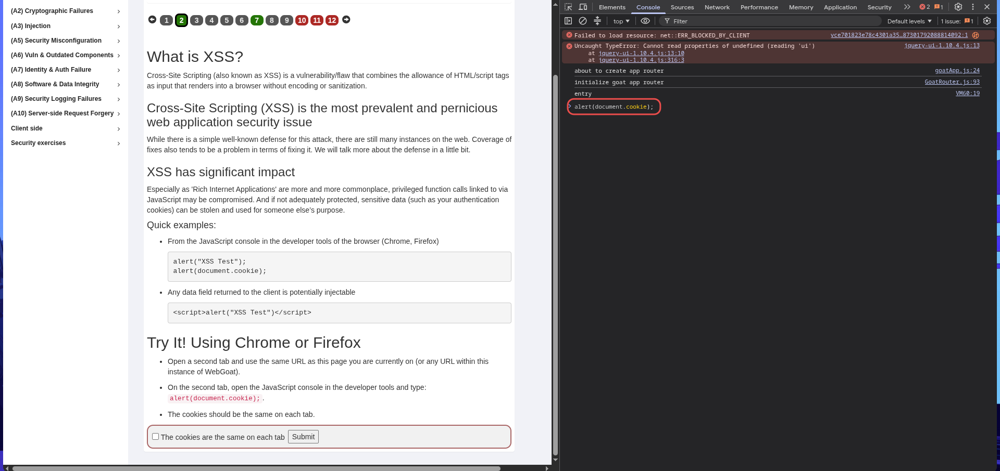
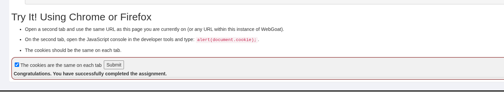

Lab 01: Cookie comparition Between two Broswer tabs

1. Root Cause 

XSS កើតឡើងនៅពេល Website មិនបានត្រួតពិនិត្យ ទិន្នន័យដែលអ្នកប្រើប្រាស់បញ្ចូលឱ្យបានត្រឹមត្រូវ មុនពេលបង្ហាញវានៅក្នុង Browser។ ដូច្នេះ Browser អាចចាត់ទុកទិន្នន័យនោះជាកូដJavaScriptជំនួសឱ្យអត្ថបទធម្មតា។

2. Evidence+

នៅក្នុង Labនេះ ខ្ញុំបានបើកTabទីពីរហើយប្រើ Developer Tools Consoleដើម្បីសាកល្បង Command៖

alert(document.cookie);

លទ្ធផលគឺ Browserបានបង្ហាញ Cookie ដែល JavaScript អាចចូលប្រើបាននៅក្នុង Alert Popup។

3. ហេតុអ្វី Payload ដំណើរការ
Command `document.cookie` ប្រើសម្រាប់អាន Cookie ដែលអាចចូលប្រើបានតាមJavaScript។ចំណែក `alert()` ប្រើសម្រាប់បង្ហាញលទ្ធផលនៅក្នុង Popup។ Cookie របស់ Tab ទាំងពីរដូចគ្នា ព្រោះវាប្រើ Website Session ដូចគ្នា។

4. What I Tried That Failed 
ក្នុងLabនេះ មិនមានការសាកល្បងណាមួយដែលបរាជ័យទេ។ Command ដែលខ្ញុំបានប្រើដំណើរការដូចការរំពឹងទុក។

5. Impact
ប្រសិនបើ Website មាន XSS Vulnerability ពិតប្រាកដAttacker អាចធ្វើឱ្យ Browser របស់អ្នកប្រើប្រាស់ដំណើរការ JavaScript ដែលមានគ្រោះថ្នាក់។ វាអាចបណ្តាលឱ្យមានការលេចធ្លាយព័ត៌មាន ឬបង្កហានិភ័យដល់ User Session។

6. Prevention 
Website គួរតែធ្វើការ Encode ទិន្នន័យមុនពេលបង្ហាញវានៅក្នុង Browser និងប្រើ HTML Sanitization នៅពេលចាំបាច់។ លើសពីនេះ Cookie សំខាន់ៗគួរតែកំណត់ `HttpOnly` ដើម្បីការពារការអាន Cookie តាម JavaScript។

7. Conclusion 
តាមរយៈ Lab នេះ ខ្ញុំបានយល់ដឹងអំពី XSS និងរបៀបដែល JavaScript អាចអាន Cookie របស់ Website។ ខ្ញុំក៏បានយល់ពីមូលហេតុដែល Website ត្រូវតែគ្រប់គ្រង User Input ឱ្យបានត្រឹមត្រូវ ដើម្បីការពារ XSS Attack។