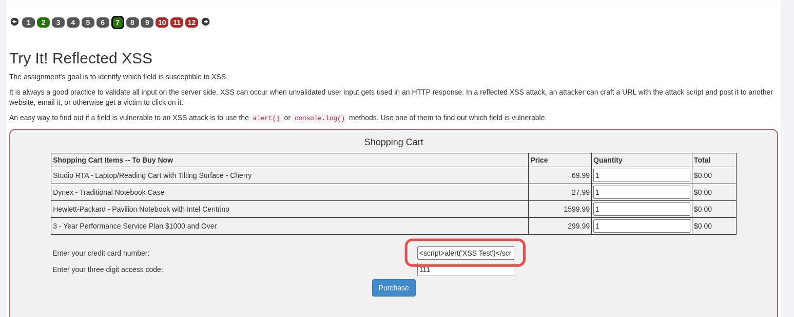

Lab 02: Reflected XSS

1. Root Cause

Reflected Cross-Site Scripting (Reflected XSS) គឺជា Vulnerability ដែលកើតឡើងនៅពេល Web Application ទទួលយកទិន្នន័យពីអ្នកប្រើប្រាស់ ហើយបង្ហាញទិន្នន័យនោះត្រឡប់ទៅក្នុង Browser ដោយមិនបានធ្វើការត្រួតពិនិត្យ ឬ Encode ឱ្យបានត្រឹមត្រូវ។

ក្នុង Lab នេះ WebGoat មាន Input Box សម្រាប់បញ្ចូលព័ត៌មានកាតឥណទាន។ នៅពេល Web Application មិនបានការពារទិន្នន័យដែលអ្នកប្រើប្រាស់បញ្ចូលឱ្យបានត្រឹមត្រូវ វាអាចធ្វើឱ្យ Browser ចាត់ទុកទិន្នន័យនោះជា JavaScript ហើយដំណើរការវា។

**Vulnerable Field:** Credit Card Number

2. Evidence

នៅក្នុង Lab នេះ ខ្ញុំបានសាកល្បងបញ្ចូល Payload ទៅក្នុង Field ទាំងពីរនៅក្នុង Shopping Cart ដើម្បីស្វែងរក Field ដែលមាន XSS Vulnerability។

Payload ដែលខ្ញុំបានប្រើ៖

```html
<script>alert('XSS Test')</script>
```



**Vulnerable Field:** Credit Card Number

បន្ទាប់ពីបញ្ចូល Payload និងចុច Submit WebGoat បានបង្ហាញសារដូចខាងក្រោម៖

> Congratulations, but alerts are not very impressive are they? Let's continue to the next assignment.

បន្ទាប់មក WebGoat បានបង្ហាញសារថា៖

> Thank you for shopping at WebGoat. Your support is appreciated.


នេះបង្ហាញថា WebGoat បានទទួលស្គាល់ការសាកល្បងរបស់ខ្ញុំ ហើយអនុញ្ញាតឱ្យបន្តទៅ Assignment បន្ទាប់។

3. Why My Payload Works

1. ខ្ញុំបានបញ្ចូល JavaScript Payload ទៅក្នុង Field ដែលងាយរងគ្រោះ។
2. Server បានទទួល Input នោះតាម HTTP Request។
3. Server បានបញ្ជូន Input ត្រឡប់មកវិញក្នុង HTTP Response ដោយមិនបានការពារត្រឹមត្រូវ។
4. Browser បានបកស្រាយ Payload ជា JavaScript ហើយបង្ហាញ Alert Popup។

Payload នេះដំណើរការបាន ប្រសិនបើ Web Application បង្ហាញ Input របស់អ្នកប្រើប្រាស់ដោយមិនបាន Encode ឬការពារឱ្យបានត្រឹមត្រូវ។

4. What I Tried That Failed

ក្នុងការសាកល្បងនេះ ខ្ញុំបានប្រើ Payload៖

```html
<script>alert('XSS Test')</script>
```

ខ្ញុំមិនបានសាកល្បង Payload ផ្សេងទៀត ឬប្រើ Burp Suite ទេ។ ដូច្នេះខ្ញុំមិនមាន Failed Payload ផ្សេងទៀតសម្រាប់រាយការណ៍ទេ។

5. Impact

ប្រសិនបើ Website ពិតប្រាកដមាន Reflected XSS Vulnerability Attacker អាចបង្កើត Malicious URL ហើយបញ្ឆោត Victim ឱ្យចុចលើវា។ បន្ទាប់មក JavaScript អាចដំណើរការនៅក្នុង Browser របស់ Victim និងបង្កហានិភ័យដល់ទិន្នន័យ ឬ User Session។

6. Prevention

Server គួរតែ Validate User Input និងប្រើ Context-Aware Output Encoding មុនពេលបង្ហាញទិន្នន័យទៅ Browser។ ការប្រើ HTML Sanitization នៅពេលចាំបាច់ ក៏អាចជួយការពារ Malicious Script ផងដែរ។

 7. Conclusion

តាមរយៈ Lab នេះ ខ្ញុំបានសិក្សាអំពី Reflected Cross-Site Scripting (Reflected XSS) និងបានសាកល្បងបញ្ចូល JavaScript Payload ទៅក្នុង Input Box របស់ WebGoat។ ខ្ញុំបានឃើញសារ Congratulations ដែលបញ្ជាក់ថា Lab បានទទួលស្គាល់ការសាកល្បងរបស់ខ្ញុំ។ ខ្ញុំក៏បានយល់ដឹងអំពីមូលហេតុ ផលប៉ះពាល់ និងវិធីការពារ Reflected XSS ផងដែរ។
