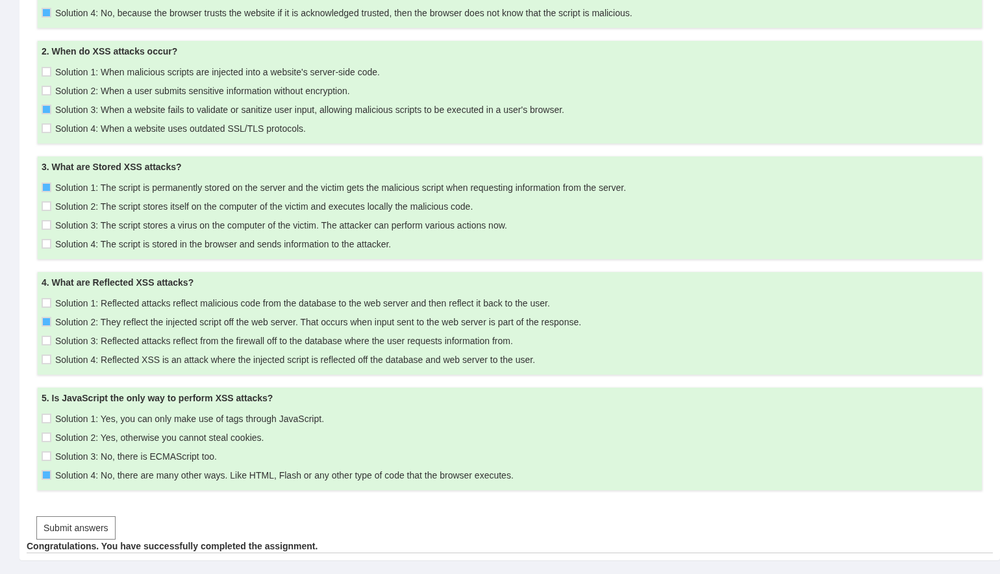

 XSS Quiz - Correct Answers

 1. Is a well known website, like Netflix, immune to XSS attacks?

**Solution 4:** No, because the browser trusts the website if it is acknowledged trusted, then the browser does not know that the script is malicious.
 2. When do XSS attacks occur?

**Solution 3:** When a website fails to validate or sanitize user input, allowing malicious scripts to be executed in a user's browser.

 3. What are Stored XSS attacks?

**Solution 1:** The script is permanently stored on the server and the victim gets the malicious script when requesting information from the server.

 4. What are Reflected XSS attacks?

**Solution 2:** They reflect the injected script off the web server. That occurs when input sent to the web server is part of the response.

 5. Is JavaScript the only way to perform XSS attacks?

**Solution 4:** No, there are many other ways. Like HTML, Flash or any other type of code that the browser executes.

