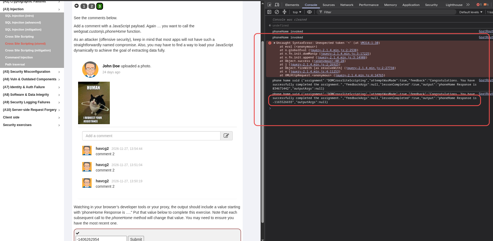
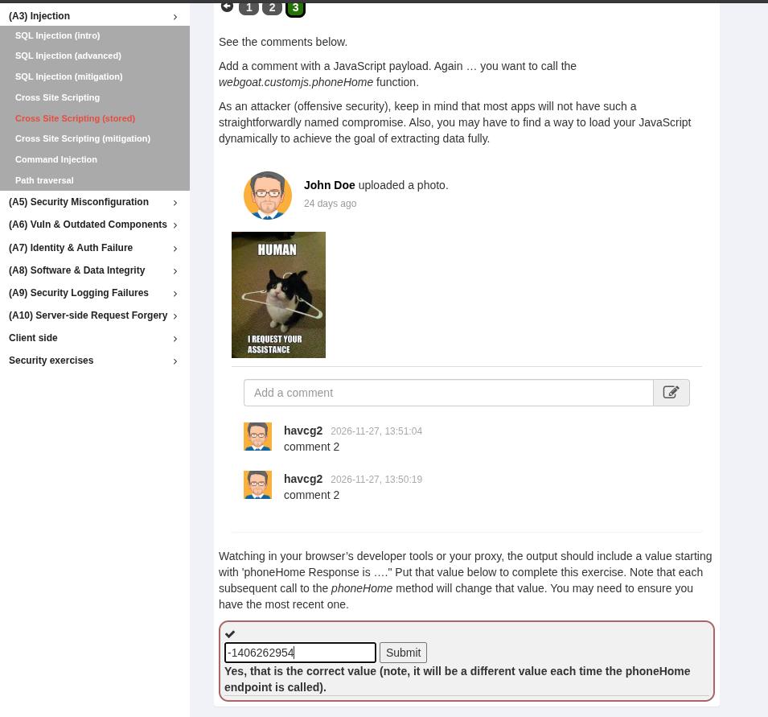

Cross-Site Scripting (Stored XSS)

1. Root Cause 

មូលហេតុគឺ Website អនុញ្ញាតឱ្យ User បញ្ចូល Comment ដែលមាន JavaScript Payload ហើយរក្សាទុកវានៅលើ Server ដោយមិនបានការពារ ឬ Encode ឱ្យបានត្រឹមត្រូវ។

នៅពេល Website បង្ហាញ Comment ដែលបានរក្សាទុក Browser អាចចាត់ទុក JavaScript ដែលអ្នកវាយប្រហារបញ្ចូលនោះជាកូដសម្រាប់ Execute ជំនួសឱ្យការបង្ហាញវាជាអត្ថបទធម្មតា។

2. Evidence 

ខ្ញុំបានសាកល្បងបញ្ចូល Payload ខាងក្រោមទៅក្នុង Comment Field៖

```html
<script>webgoat.customjs.phoneHome();</script>
```

បន្ទាប់ពី Submit Comment នោះ WebGoat បានរក្សាទុក និងបង្ហាញ Comment នៅលើទំព័រ។

នៅពេល Payload ត្រូវបាន Execute ខ្ញុំអាចពិនិត្យមើល Browser Developer Tools Console ដើម្បីរក Response ដែលចាប់ផ្ដើមដោយ៖

```text
phoneHome Response is ...
```





3. Why Your Payload Works

Payload នេះដំណើរការដោយសារវាប្រើ HTML `<script>` Tag ដើម្បីឱ្យ Browser Execute JavaScript។

ជំហាននៃការដំណើរការ៖

1. `<script>` ប្រាប់ Browser ថាខ្លឹមសារខាងក្នុងជា JavaScript។
2. `webgoat.customjs.phoneHome()` ហៅ Function `phoneHome()` របស់ WebGoat។
3. `</script>` បញ្ចប់ Script Tag។
4. WebGoat រក្សាទុក Comment ដែលមាន Payload នៅលើ Server។
5. នៅពេល Browser បង្ហាញ Comment នោះ ប្រសិនបើគ្មានការការពារត្រឹមត្រូវ JavaScript អាចត្រូវបាន Execute។
6. Function `phoneHome()` បង្កើត Response Value ដែលអាចមើលឃើញនៅក្នុង Browser Console។


4. Impact 

Stored XSS អាចប៉ះពាល់ដល់ User ផ្សេងៗដែលចូលមើលទំព័រដែលមាន malicious comment។
អ្នកវាយប្រហារអាចប្រើ JavaScript ដើម្បីធ្វើសកម្មភាពក្នុង Context របស់ Website ដូចជា៖
- លួចទិន្នន័យដែលអាចចូលប្រើបានតាមរយៈ Browser។
- ធ្វើសកម្មភាពជំនួស User ប្រសិនបើ Session និងសិទ្ធិអនុញ្ញាតអាចត្រូវបានប្រើប្រាស់។
- បង្ហាញទំព័រក្លែងក្លាយ ឬបញ្ជូន User ទៅកាន់ Website ព្យាបាទ។

ផលប៉ះពាល់ពិតប្រាកដអាស្រ័យលើ Security Controls របស់ Website និង Browser។

5. Prevention 

Website គួរតែ Encode User Input មុនពេលបង្ហាញវានៅក្នុង HTML ដើម្បីកុំឱ្យ Browser Execute Script ដែលអ្នកប្រើបានបញ្ចូល។ ប្រសិនបើ Website អនុញ្ញាតឱ្យប្រើ HTML ក្នុង Comment គួរតែប្រើ HTML Sanitization និង Content Security Policy (CSP) ជាស្រទាប់ការពារបន្ថែម។
