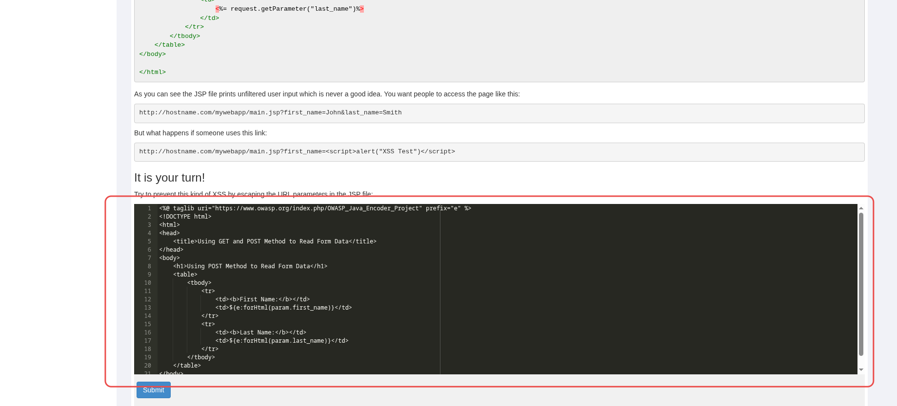

 Reflective XSS Prevention

1. Root Cause 

មូលហេតុគឺ JSP File ប្រើ `request.getParameter()` ដើម្បីទាញយក User Input ពី Request ហើយបង្ហាញវាដោយផ្ទាល់នៅក្នុង HTML ដោយមិនបាន Encode។

ការបង្ហាញ User Input ដោយមិនមានការការពារត្រឹមត្រូវ អាចអនុញ្ញាតឱ្យ Attacker បញ្ចូល JavaScript Payload ដែលអាចត្រូវបាន Execute នៅក្នុង Browser របស់អ្នកប្រើប្រាស់។

 2. Evidence (ភស្តុតាង)

JSP Code ដើមបង្ហាញ User Input ដោយផ្ទាល់៖

```jsp
<%= request.getParameter("first_name")%>
<%= request.getParameter("last_name")%>
```

ដើម្បីការពារ Reflective XSS ខ្ញុំបានកែប្រែ JSP Code ដោយប្រើ OWASP Java Encoder៖

```jsp
<%@ taglib uri="https://www.owasp.org/index.php/OWASP_Java_Encoder_Project" prefix="e" %>

<td>${e:forHtml(param.first_name)}</td>
<td>${e:forHtml(param.last_name)}</td>
```

បន្ទាប់ពីកែប្រែ Code និងសាកល្បងក្នុង WebGoat វាបានបង្ហាញលទ្ធផលជោគជ័យ ហើយ Lab បានទទួលយកដំណោះស្រាយ។





3. Why Your Payload Works 

ខ្ញុំបានប្រើ OWASP Java Encoder ដើម្បី Encode User Input មុនពេលបង្ហាញវានៅក្នុង HTML។

ជំហាននៃការដំណើរការ៖
1. `<%@ taglib ... prefix="e" %>` Import OWASP Java Encoder Tag Library។
2. `param.first_name` ទាញយក First Name ពី Request Parameter។
3. `param.last_name` ទាញយក Last Name ពី Request Parameter។
4. `e:forHtml()` Encode User Input ដើម្បីកុំឱ្យ HTML Special Characters ត្រូវបានបកស្រាយជាផ្នែកនៃ HTML។
5. Browser បង្ហាញទិន្នន័យជា Text ជំនួសឱ្យការប្រតិបត្តិ Malicious HTML ឬ JavaScript។

ដូច្នេះ Payload ដូចជា `<script>alert("XSS Test")</script>` មិនគួរត្រូវបាន Execute នៅពេលបង្ហាញក្នុង HTML Text Context នោះទេ។

4. What You Tried That Failed 

ដំបូង JSP Code ប្រើ `request.getParameter()` ដើម្បីបង្ហាញ User Input ដោយផ្ទាល់ ដោយមិនមាន HTML Encoding។

វិធីនេះមិនមានសុវត្ថិភាពទេ ព្រោះ User Input អាចមាន HTML ឬ JavaScript ដែលអាចត្រូវបាន Browser បកស្រាយ។

បន្ទាប់មក ខ្ញុំបានសាកល្បងប្រើ OWASP Java Encoder ជាមួយ `e:forHtml()` ហើយ WebGoat បានទទួលយកដំណោះស្រាយ។

 5. Impact

ប្រសិនបើ Reflective XSS មិនត្រូវបានការពារ Attacker អាចបង្កើត URL ដែលមាន Malicious JavaScript នៅក្នុង Parameter ហើយបញ្ឆោត Victim ឱ្យចុចលើ URL នោះ។

ប្រសិនបើ Script ត្រូវបាន Execute វាអាចត្រូវបានប្រើដើម្បី៖
- លួចព័ត៌មានដែលអាចចូលប្រើបានតាមរយៈ Browser។
- បង្ហាញ Fake Content ឬ Phishing Message។
- ធ្វើសកម្មភាពជំនួស Victim ក្នុង Context របស់ Website ប្រសិនបើលក្ខខណ្ឌអនុញ្ញាត។

 6. Prevention 
គួរតែ Encode User Input មុនពេលបង្ហាញវានៅក្នុង HTML ដោយប្រើ Context-Aware Output Encoding ដូចជា OWASP Java Encoder។ ក៏គួរតែជៀសវាងការបង្ហាញ Untrusted Input ដោយផ្ទាល់ និងប្រើ Encoding ដែលត្រឹមត្រូវទៅតាម Context របស់ HTML។
